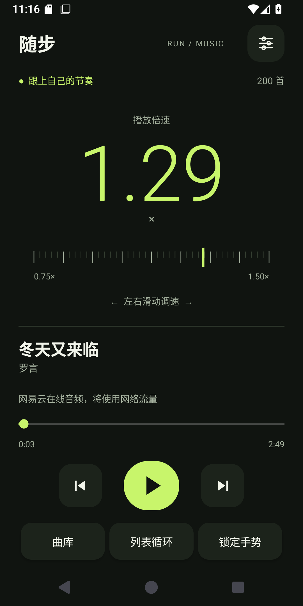

# StrideTune（随步）

给跑步时手动对齐节奏用的 Android 音乐播放器。原生 Java 界面和 Media3 音频引擎，无账号、无广告、无自建服务器。支持 Android 8.0 及以上。

**[下载 Android 试用版 APK](https://github.com/GPDdev/StrideTune/releases/download/v0.1.0/StrideTune-0.1.0.apk)** | [版本说明与校验文件](https://github.com/GPDdev/StrideTune/releases/tag/v0.1.0)



## 使用

1. 从上方链接下载并安装 APK，从「曲库」添加音频或网易云歌单。自行构建的安装包位于 `outputs/RunMusic-0.1.0.apk`。
2. 选择歌曲并播放。在中间的大块区域向右滑动加速，向左滑动减速；抬手保留当前倍速，下一次从当前值继续调节。
3. 默认 0.75–1.50 倍，滑满区域变化 0.50 倍，变速不变调。双击调速区恢复 1.00 倍；如果设置范围不包含 1.00，则回到最近的边界。
4. 右上角可设置横向 / 纵向手势、反转方向、按住后滑动、灵敏度、倍速范围、双击复位、音调保持、震动和亮屏。允许设置的范围为 0.25–3.00 倍。
5. 「锁定手势」暂停接收调速操作；播放和切歌按钮仍可用。「列表循环」按钮切换单曲循环和随机播放。

## 音频导入

- 本地音频通过系统文件选择器多选导入，保留文件访问权限，不移动或修改原文件。MP3、AAC / M4A、FLAC、WAV、OGG 等格式的实际支持以系统解码器为准。
- 网易云支持数字歌单 ID、完整歌单链接、分享文本，以及可通过 HTTP 跳转解析的 `163cn.tv` 短链接。也可从网易云分享到随步。
- 当前使用无需登录的公开歌单信息接口和公开音频外链，已实测一份公开歌单及一条音频外链。这些接口没有官方稳定性保证，不能保证所有歌曲可播放；部分歌曲可能仅试听。歌单未完整返回时，会显示实际导入数和总数。
- 多次导入合并进当前曲库，重复歌曲按来源 ID 去重并保留顺序。标题相同且唯一的本地文件会自动匹配网易云歌曲；重名时不自动匹配，长按歌曲手动绑定。
- 长按歌曲可以绑定 / 更换本地音频或从曲库移除。移除不删除手机上的文件。
- 不能直接读取 NCM 等加密缓存，不接管网易云 App 的播放，不包含会员授权或付费歌曲解锁。

## 跑步时的行为

- 主界面保持亮屏可关闭。锁屏或切换应用后由媒体播放服务继续播放，支持系统媒体通知及耳机控制；熄屏后无法接收屏幕滑动。
- 拔掉有线耳机或发生相应的音频设备断开事件会暂停；音频焦点交由播放器和系统处理。
- 记录曲库、设置、当前歌曲、倍速及播放进度，重启不自动开始播放。播放中约每 5 秒保存进度，突然结束进程时可能丢失最后几秒。
- 首版使用竖屏。没有自动测步频或自动 BPM 匹配功能，需要手动滑动调节。
- 在线歌曲需要网络；绑定本地文件后可离线播放。文件被移动、删除或授权失效时，需要重新绑定。

## 构建与检查

需要 Windows、Python 3、JDK 17 或 21，以及访问 Google Maven 和 Maven Central 的网络。

```powershell
python scripts/bootstrap.py
./scripts/build.ps1 -Check
```

脚本在 `.tools/` 中下载并校验官方 Gradle 8.11.1、Android SDK API 35、Build Tools 35.0.0 和 platform-tools，不修改系统环境变量。构建缓存和 SDK 不提交到 Git。构建时应遵守相应 Android SDK 许可条款。

`-Check` 执行 APK 构建、JUnit 测试和 Android Lint。安装包使用 Android 调试签名，适合直接安装试用，尚不是应用商店发行包。保留本机调试密钥，才能在后续版本中覆盖安装。

源码入口在 `app/src/main/java/org/hachile/runmusic`。`SpeedConfig` 负责倍速规则，`GesturePad` 负责触摸，`PlaybackService` 负责播放，`NeteaseClient` 负责公开歌单读取。

## 本版验证

- APK 编译成功，6 个 JUnit 测试通过，Android Lint 为 0 错误、11 条警告（包括固定竖屏、依赖版本和界面建议）。APK v2 签名校验通过。
- Android 15 x86_64 模拟器：通过系统文件选择器导入 WAV 后正常播放；滑动实际改变播放器速度，手势锁、双击复位、纵向手势、自定义上下限、重启恢复均已验证。
- 最终 APK 切到后台及熄屏后，系统媒体会话仍报告播放中；倍速更新不会再重写曲库文件。
- App 内成功导入公开网易云歌单 `3778678` 的 199 首曲目，并实际播放其中一首公开音频。
- 未进行实体手机、蓝牙耳机、长时间续航、户外跑步及听感质量验证，也未开发 iOS 版本。

实际截图在 `docs/interface.png`，验证摘要与 SHA-256 校验文件随 GitHub Release 发布。本地构建输出与工具缓存不上传到仓库。
